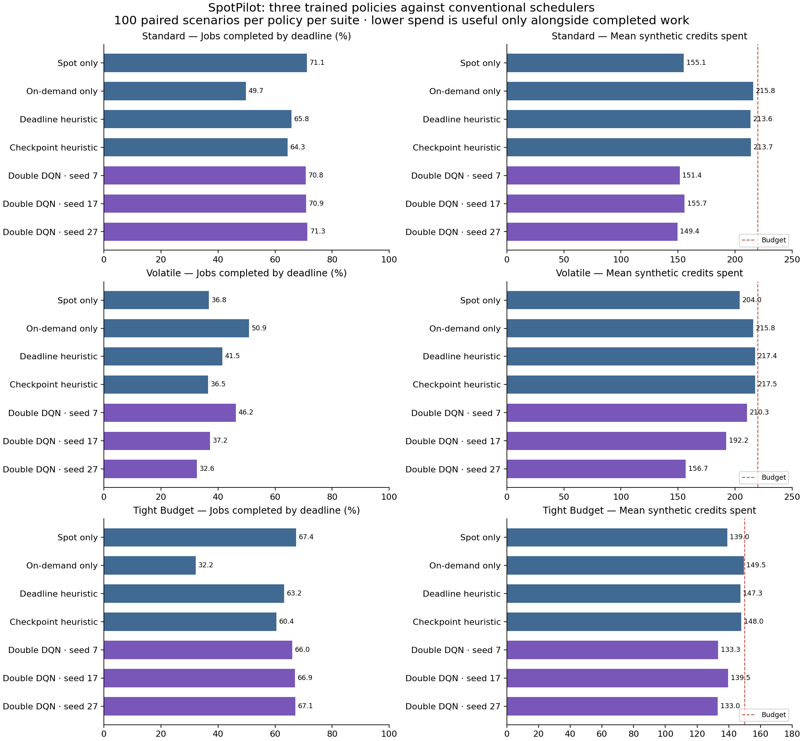

# SpotPilot

### Reinforcement learning for cloud scheduling — by Tabish Syed

**Learn when to use cheap, interruptible compute, when to pay for reliability, and when to checkpoint work—all under a hard budget.**

SpotPilot is a reproducible cloud scheduling research project with a custom Gymnasium environment, a NumPy Double DQN policy, conventional schedulers, an independent event-log auditor, and a real subprocess checkpoint/resume demonstration. Trained weights and benchmark results are included.

The scheduling environment simulates cloud resources and billing. It does not provision AWS, Azure, or Google Cloud resources. All prices are synthetic integer credits, not real currency or provider quotes. The real worker experiment runs locally or in Docker and is separate from the scheduling simulator.

## Measured result

The default trained policy completed **70.75%** of jobs in the standard suite, versus **71.08%** for spot-only, with mean spend of **151.45** versus **155.10** synthetic credits. All **2400 benchmark episodes** passed accounting and budget audits. Performance under shifted markets varied substantially across training seeds; this model does not consistently outperform the baselines.



[Full results](artifacts/RESULTS.md) · [Model card](MODEL_CARD.md) · [Training and reproduction](#trained-model-and-reproducibility)

## Quick start

Requires Python 3.10+; Python 3.11 or 3.12 is recommended. No cloud account, API key, GPU, or paid service is required. Run from the repository root:

```bash
python3 -m venv .venv
source .venv/bin/activate
pip install -e '.[dev]'
pytest -q
spotpilot demo
spotpilot demo --suite volatile --output runs/volatile-demo.json
spotpilot worker-demo --output runs/worker
```

On Windows activate `.venv\Scripts\activate`. The RL demos load `artifacts/seed7/policy.npz` and write auditable JSON traces. The worker demo deliberately interrupts a process, resumes from its checkpoint, and verifies the final output against uninterrupted execution. Use a fresh output directory for worker demos and training.

## Why this problem?

Spot compute can be cheaper but interruptible. Frequent checkpoints reduce lost work while consuming time and resources. Reliable compute avoids interruptions but can exhaust the budget before every job finishes. A policy must balance deadlines, price, risk, and remaining work rather than simply choose the cheapest machine.

This is an established research problem. SpotPilot's contribution is an inspectable implementation with trained models, paired comparisons, explicit accounting, and documented limitations—not a claim that RL cloud scheduling is new.

## Scheduling environment

An episode contains 12 jobs, up to 48 time slots, and at most two active workers. Each job needs 3–8 uninterrupted-or-checkpointed work units. Jobs arrive during slots 0–20; deadlines depend on arrival, work, and a sampled slack allowance. A job earns credit only when completed by its deadline.

| Action | Requested configuration |
|---|---|
| 0 | Stop all workers |
| 1 | One spot worker |
| 2 | Two spot workers |
| 3 | One on-demand worker |
| 4 | Two on-demand workers |
| 5 | One spot and one on-demand worker |
| 6 | Checkpoint currently allocated jobs; no useful work this slot |

Ready jobs are assigned by earliest deadline, with job ID as the tie-breaker. RL controls capacity and checkpointing, while dispatch order is fixed. Actions 0–5 maintain matching workers and stop workers whose type or slot changes. Stopping a worker discards progress since the last checkpoint. Checkpoints survive interruption and worker changes. Finished jobs release workers immediately; idle configurations with no available jobs are not billed.

A spot interruption happens before useful work or checkpoint completion, but the reserved slot is still billed. It discards unsaved progress and releases that worker. A checkpoint uses a full billed slot plus one storage credit per allocated job, including a failed checkpoint attempt. Checkpointing pauses all allocated workers. On-demand workers have no modeled failures.

Standard spot prices are 1–3 credits per worker-slot, with interruption probabilities drawn from 2%, 6%, 12%, and 20%. Markets change every eight slots. On-demand costs six credits per worker-slot. The standard episode budget is 220 credits.

## Budget enforcement and verification

Before any compute executes, a guard calculates the exact cost of the allocated workers for that slot. If it exceeds the remaining budget, the entire allocation is rejected and workers are released. This can lose unsaved work. The guard enforces the limit even for a random or poorly trained policy; reward penalties alone are not relied on for budget safety.

Every recorded episode has an event ledger containing allocation, execution, checkpoint, interruption, completion, expiration, and billing events. A separate verifier reconstructs job progress and charges, checks interruptions against the scenario trace, rejects duplicate allocations and invalid work, validates deadline outcomes, and enforces the budget. Benchmarking raises an error if an audit fails.

This is logical verification in the same Python process, not a security sandbox against malicious code. Evidence and scenario inputs are assumed trusted. Passing an audit means the episode is internally consistent; it does not mean the schedule is optimal.

## Observations and reward

The 24 normalized features expose current time, remaining budget, current spot price and interruption probability, ready/future/completed/missed job counts, minimum slack, remaining work, worker types, each worker's current and saved progress, per-worker slack, recent lost work, budget per remaining work, and market phase. The complete job queue and future market trace are hidden, so the observation is partially observable. The exact current interruption probability is disclosed in this simulator; production systems would require an estimator.

Reward per slot:

```text
+4 × jobs completed on time
-2 × jobs that expire
-0.02 × credits spent
-0.08 × work units lost
```

The episode ends when all jobs are completed or expired, with a 48-slot horizon. The learner treats either terminal or truncated transitions as the end of the observed finite task. There is no action masking, expert replay, or curriculum.

## Trained model and reproducibility

The learner is Double DQN implemented in NumPy: 24 inputs, 64 ReLU hidden units, and seven action values. It uses a 30000-transition replay buffer, batches of 64, Huber loss, Adam at 0.0007, discount 0.98, and a target network copy every 250 updates. Learning starts at 512 transitions and updates every four steps. Exploration falls to 0.08 over 75% of training.

Three independent network/learner seeds—7, 17, and 27—are trained for 80000 steps each on the standard suite. Training scenario sequences overlap across runs, so these are three learner seeds rather than disjoint training datasets. Each run selects its own checkpoint using mean return on 20 fixed validation scenarios starting at seed 50000. Seed 7 is the default model, designated before held-out evaluation.

```bash
OPENBLAS_NUM_THREADS=1 spotpilot train --steps 80000 --seed 7 --output runs/my-training
spotpilot demo --model runs/my-training/policy.npz --output runs/my-demo.json
spotpilot benchmark --models artifacts/seed7/policy.npz artifacts/seed17/policy.npz artifacts/seed27/policy.npz --episodes 100 --output runs/benchmark.json
```

Training requires a new output directory. `policy.npz` is the selected checkpoint; `last_policy.npz` is the final network. Checkpoints hold inference weights, not replay or optimizer state, so exact training resumption is not supported. Models are loaded without pickle and validated for shape and finite numeric values.

## Evaluation

Baselines are idle, spot-only, on-demand-only, a price/risk/deadline-aware heuristic, and a heuristic that also checkpoints at-risk spot progress. The heuristics use the same observation vector as the learner. They are transparent references, not tuned production schedulers or optimal solutions.

Every policy sees identical job arrivals, market prices, risk, and per-worker-slot interruption draws for a scenario. Different allocations can expose policies to different parts of that same trace. Training, validation, and final evaluation scenario seed ranges are separate.

| Suite | Budget | Spot conditions | Evaluation seeds |
|---|---:|---|---|
| Standard | 220 | Prices 1–3; risk 2–20% | 300000–300099 |
| Volatile | 220 | Prices 1–5; risk 12–40% | 400000–400099 |
| Tight budget | 150 | Same market distribution as standard | 500000–500099 |

The latter two suites change conditions unseen in training. They are specific distribution shifts, not evidence of general adaptation. Reported metrics include on-time completion, credits spent, lost work, interruptions, rejected allocations, and return. Cost alone rewards doing no work, so interpret it alongside completion rate. Raw episode-level metrics and all three learned policies are included in the benchmark report.

See [results](artifacts/RESULTS.md), [model card](MODEL_CARD.md), and [raw benchmark](artifacts/benchmark.json).

## Real checkpoint/resume experiment

The bundled worker computes a deterministic hash chain over 40 work chunks. It checkpoints every five chunks, is abruptly terminated at chunk 17, resumes from chunk 15, and must match an uninterrupted reference exactly. This demonstrates real process recovery but does not calibrate the simulator's job runtime, cloud billing, or checkpoint cost.

The same experiment runs inside a non-root container using only the Python standard library:

```bash
docker build -f Dockerfile.worker -t spotpilot-worker .
docker run --rm --network none --read-only \
  --tmpfs /tmp:rw,nosuid,size=32m --cap-drop ALL \
  --security-opt no-new-privileges --memory 128m --cpus 1 \
  --pids-limit 64 spotpilot-worker
```

The temporary checkpoint survives worker-process termination within that container. The example does not demonstrate survival after host power failure or container deletion, and it does not persist its tmpfs after exit. An actual cloud implementation would need durable external checkpoint storage.

## Python API

```python
import gymnasium as gym
import spotpilot

with gym.make('SpotPilot-v0') as env:
    obs, info = env.reset(seed=42)
    finished = False
    while not finished:
        obs, reward, terminated, truncated, info = env.step(env.action_space.sample())
        finished = terminated or truncated
    print(info)
```

## Project structure

- `spotpilot/scenario.py`: reproducible jobs, prices, and interruption traces.
- `spotpilot/env.py`: scheduling transitions and budget admission.
- `spotpilot/verifier.py`: independent event-ledger audit.
- `spotpilot/agent.py`: NumPy Double DQN and replay.
- `spotpilot/baselines.py`: conventional schedulers.
- `spotpilot/evaluation.py`: paired, audited evaluation.
- `spotpilot/worker.py`: real process interruption and recovery.
- `spotpilot/cli.py`: training, benchmark, and demo commands.
- `tests/`: budget, deadline, checkpoint, verifier, model, and worker tests.
- `artifacts/`: checkpoints, training records, results, and traces.

## Boundaries and future work

There is no live cloud adapter in v0.1. The simulator omits boot delay, minimum billing periods, networking, quotas, correlated fleet failures, variable worker speed, checkpoint transfer time, and changing job resource requirements. It uses synthetic prices and a perfect current risk signal. The rule-based job dispatcher and two-worker limit constrain the policy's control.

Next steps are recorded cloud traces, calibrated worker costs, stronger optimization baselines, additional learner seeds, recurrent policies for partial observability, and a separately authorized cloud execution adapter with external spending limits. The included checks establish tested behavior, not a guarantee that software is bug-free.

## Authorship and license

Created for **Tabish Syed's portfolio**. [MIT License](LICENSE). The NumPy learner is adapted from the earlier MigrationGym/IndexGym/CacheGym projects; the copyright notice is retained. AI tools assisted implementation, testing, and documentation.
